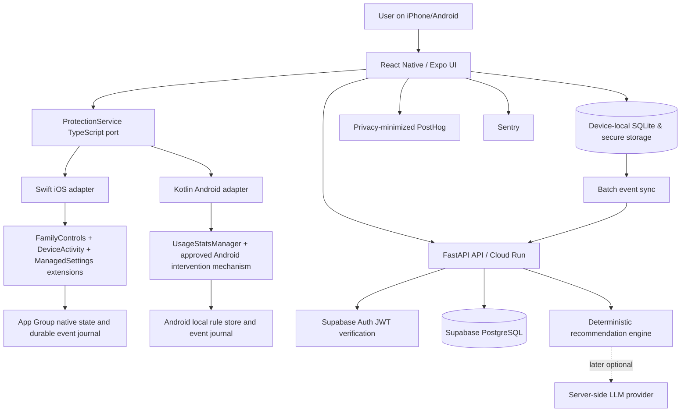

# Disconnect — Technical Specification Document (TSD)

**Version:** 1.1 — adopted M1/M2 foundation contracts; later domains remain proposed

**Date:** 2026-10-28  
**Companion:** `PRD.md`, `AGENT_START_HERE.md`  
**Design:** [Figma App-UI](https://www.figma.com/design/ukmD2ZidJ9UR2XxUkvdPoJ/App-UI?node-id=0-1)  
**Architecture proposal:** React Native + TypeScript + Expo development builds / Expo modules + retained native Swift + native Kotlin + FastAPI + managed PostgreSQL/Supabase Auth  
**Core constraint:** **Do not rewrite tested iOS Screen Time code.** An agent must inspect the existing repository and adapt this design to actual native targets.

> **Implementation contract:** Code below is a *reference scaffold/contract*, not a claim that an existing repo has exactly these paths or that every platform snippet can be pasted unchanged. Platform APIs, entitlement scopes, and implementation semantics must be verified against the pinned SDK and tested on physical devices. Anything labeled `TODO(DECISION)` requires founder approval before production enforcement.

---

## 0. Non-negotiable engineering invariants

1. **Native enforcement is authoritative.** No JS timer, React Native background timer, HTTP request, LLM output or Supabase availability is necessary for already-installed native restrictions to operate.
2. **The iOS native working implementation is an asset:** preserve existing `DeviceActivityMonitor`, `ManagedSettings`, shield configuration/action, FamilyControls distribution entitlement, extension targets, app group and release identity. Tests already reported by the team cover app termination, restart, lock/unlock, timezone change, timer, blocking and generic nudge.
3. **Android behavior is unproven:** do not claim iOS-equivalent shield or persistent forced blocking on Android without proving a compliant method on physical devices and reviewing Play policy.
4. **Reason-based restriction composition:** active restrictions are the union of applicable independent reasons; removing one reason must not clear any other reason. Every rule has stable `reason_id`, priority, lifecycle, revision and source.
5. **Explicit protection state:** `ACTIVE` only means a native configuration was actually accepted/installed. `PENDING`, `NEEDS_PERMISSION`, `DEGRADED`, `FAILED`, etc. are distinct.
6. **Opaque iOS selection tokens are device-local.** Do not serialize FamilyActivitySelection/ApplicationToken to the FastAPI backend by default. Maintain accurate privacy disclosures. More granular 2026 data access may require the *additional* Family Controls App and Website Usage entitlement and user consent; the base Family Controls distribution entitlement must not be mistaken for blanket usage-data access.
7. **Never generate a misleading usage or behavioral outcome.** Screen Time reports, activity thresholds, shield-button actions and user self-reports are distinct evidence types.
8. **Idempotency and revisioning:** duplicate native callbacks, HTTP retries, repeated button taps and reboots must not duplicate credits or leave stale locks.
9. **Fail predictably:** permission revocation, data corruption, extension callback failure, backend outage and outdated plans have explicit handling. Critical restrictions should follow the intended native policy, not silently unlock due to network failure; users must not be stuck with stale voluntary restrictions.
10. **Small infrastructure footprint:** one modular FastAPI API; no Kubernetes, Redis, Kafka, custom OAuth service or ML platform until justified by actual load.
11. **Read the PRD decision register:** session semantics, overlap priority, allowance extension and reward policy are NOT fully specified by Figma. Agents may implement configurable models with tests, but not ship guessed user-facing rules.

## 1. Existing status and targets

| Surface | Status / evidence | Engineering action |
|---|---|---|
| iOS Screen Time entitlement | [TEAM VERIFIED] Distribution entitlement already obtained | Audit target-specific signing/capability; do not reapply absent need |
| iOS native app restriction | [TEAM VERIFIED] Blocking, preventing use, generic nudge, timers | Reuse code; regression test after integration |
| iOS background continuity | [TEAM VERIFIED] Works when app terminated; restart/locked/timezone tested | Preserve extension-first architecture and test in signed build |
| iOS RN bridge | [UNKNOWN] | Implement minimal adapter around current Swift, without rewriting native core |
| Android native restriction | [UNPROVEN] | Dedicated feasibility spike and Play-policy assessment |
| Full React Native UI | [DESIGNED] See PRD Figma ID inventory | Build shared screens, navigation, forms and feedback |
| FastAPI/backend | [PROPOSED] May not exist in current codebase | Inspect and reuse existing services first; only build missing modules |
| AI nudge generation | Legacy Swift/Firebase source imported; no new RN/FastAPI integration or fresh live validation | Audit/reuse cached source and fallback; keep new integration separately gated |
| Server analytics | [UNKNOWN] | Add measured event taxonomy and privacy-safe sync |

## 2. Target system topology



**Authority matrix:**

| Domain | System of record | Read replicas / consumers |
|---|---|---|
| Login identity | Supabase Auth | FastAPI JWT verifier, RN auth client |
| User goals, approved plan spec, quests | PostgreSQL canonical record | Local cached plan and scheduled native rules |
| iOS selected app tokens | iOS App Group protected storage | Native monitor/selection UI; **not** server |
| Android selected package identifiers | Device-local store by default | Kotlin enforcement, opt-in aggregate analytics |
| Actual installed native monitor status | Native OS + native coordinator | React Native `getProtectionStatus()` |
| In-flight session and override timers | Native layer | React Native summary UI |
| Rewards ledger | PostgreSQL | Local optimistic/pending UI and server reconciliation |
| Raw event journal while offline | SQLite/device-native durable storage | Batched upload to API |
| Supported usage reports | Native platform, according to permitted APIs | UI only or privacy-allowed derived summary |
| Personalization templates | Versioned bundled templates / API | Cache on device; native extension must not fetch AI in hot path |

### 2.1 Suggested repository layout

**This is a new-repo proposal; preserve the actual current repo layout and production identifiers where appropriate.**

```text
disconnect/
├── README.md
├── AGENT_START_HERE.md
├── apps/
│   └── mobile/
│       ├── app/                      # Expo Router; onboarding, tabs and modal routes
│       │   ├── (auth)/
│       │   ├── (onboarding)/
│       │   ├── (tabs)/
│       │   │   ├── index.tsx         # Home
│       │   │   ├── quests.tsx
│       │   │   ├── history.tsx
│       │   │   └── settings.tsx
│       │   └── quest/[id].tsx
│       ├── src/
│       │   ├── features/
│       │   │   ├── onboarding/
│       │   │   ├── protection/
│       │   │   ├── plans/
│       │   │   ├── quests/
│       │   │   ├── rewards/
│       │   │   ├── history/
│       │   │   └── account/
│       │   ├── components/ui/
│       │   ├── design/tokens.ts
│       │   ├── domain/               # TS schema, policy, pure logic
│       │   ├── infrastructure/
│       │   │   ├── api/
│       │   │   ├── auth/
│       │   │   ├── db/
│       │   │   ├── events/
│       │   │   └── native/
│       │   └── test/
│       ├── modules/
│       │   └── disconnect-protection/ # Expo Module bridge, Swift/Kotlin adapters
│       ├── ios/                      # KEEP/maintain when it protects original extensions
│       │   └── ...                   # Existing native targets; do not blindly generate
│       ├── android/
│       ├── assets/                    # Original exported Figma mascot/vector assets
│       ├── app.config.ts
│       └── eas.json
├── services/
│   └── api/
│       ├── app/
│       │   ├── main.py
│       │   ├── api/v1/
│       │   │   ├── dependencies.py
│       │   │   ├── profiles.py
│       │   │   ├── plans.py
│       │   │   ├── quests.py
│       │   │   ├── events.py
│       │   │   ├── rewards.py
│       │   │   └── insights.py
│       │   ├── core/                  # settings, auth, errors, observability
│       │   ├── db/                    # SQLAlchemy session / migrations
│       │   ├── models/
│       │   ├── schemas/
│       │   ├── services/
│       │   │   ├── rule_engine.py
│       │   │   ├── quest_engine.py
│       │   │   ├── reward_engine.py
│       │   │   ├── recommendation_engine.py
│       │   │   └── event_ingest.py
│       │   └── workers/
│       ├── alembic/
│       ├── tests/
│       ├── pyproject.toml
│       └── Dockerfile
├── packages/
│   ├── contracts/                    # Type-only domain ports; generated OpenAPI HTTP types in API-05
│   └── product-config/               # Versioned non-secret policy & copy
├── infra/
│   ├── cloud-run/
│   └── github-actions/
├── docs/
│   ├── architecture/
│   ├── adrs/
│   ├── figma-map.md
│   ├── native-test-matrix.md
│   ├── privacy-data-map.md
│   └── runbooks/
└── .github/workflows/
```

**Selected foundation tooling:** npm workspace for RN/contracts; `uv` + committed `uv.lock` for Python; maintain source + migrations in one repository unless there is a clear organizational reason to split.

### 2.2 Why keep a modular monolith?

- Common auth and simple deployment in one FastAPI instance.
- `profiles`, `plans`, `quests`, `rewards`, `insights`, `events` are modules, **not** separate services.
- Add background jobs only for real work: digest emails, noncritical data aggregation, and optionally LLM suggestions.
- Avoid synchronous network calls from native OS extension callbacks.
- Cloud Run scales API instances independently of device monitoring; Postgres pooling is critical when instances scale out.

## 3. Platform abstraction: strongly typed bridge contract

The type-only [contracts package](../packages/contracts/README.md) is authoritative
for the shared boundary. Anisha owns the Swift adapter; Ishmum owns Kotlin and
shared status UI. The [accepted identity decisions](architecture/identity-foundation.md)
and [Plan 00](core_plan/00_shared_contracts.md) distinguish bridge availability,
OS authorization, and installed-rule status. No native adapter exists in this checkout.

```ts
import type {
  AuthSessionPort,
  ProtectionIntegration,
  ProtectionService,
  NativeProtectionStatus,
} from '@disconnect/contracts';
```

`ProtectionIntegration` is `not_connected`, `unsupported`, or `connected`. Only
`connected` exposes a `ProtectionService`; connection itself does not prove permission
or installation. An `active` `NativeProtectionStatus` requires `authorized` permission
and a numeric installed revision. Native adapters must validate the actual revision,
capabilities, permissions and native method results before reporting that state.

The draft policy port is maintained in
[`packages/contracts/src/protection.ts`](../packages/contracts/src/protection.ts).
It is not finalized session/override/quest policy. App selection returns only a
summary/device-local handle; original iOS selection tokens stay native. Calling a
React Native temporary-allowance method does not substitute for a shield-action
extension callback: the extension updates local rule state independently of JS startup.

### 3.1 Bridge integration sketch (Expo Modules)

This is a consumer sketch, not a registered module or successful native implementation:

```ts
import type { ProtectionIntegration } from '@disconnect/contracts';

export async function confirmedForRevision(
  integration: ProtectionIntegration,
  revision: number,
): Promise<boolean> {
  if (integration.availability !== 'connected') return false;
  const status = await integration.service.getStatus();
  return status.state === 'active' && status.installedRevision === revision;
}
```

Anisha audits the existing Swift module/targets before choosing actual export names;
Ishmum verifies Android capabilities before claiming equivalent behavior. Handle
bridge initialization failures truthfully as unavailable, never a successful mock.
Read the pinned Expo Modules API when implementing. If using Expo CNG, extension
targets require a config plugin and explicit credentials mapping; if keeping native
`ios/` checked in, do not regenerate away working targets. See §5.7.

## 4. Native restriction policy and state machine

### 4.1 Shared policy semantics

Keep the policy model separate from the OS hooks. **This is a proposed domain design; exact transitions require PD-01..PD-04 decisions.**

```text
UNCONFIGURED --(permission + selection + valid plan)--> INSTALLING
INSTALLING   --(native confirmed)---------------------> PROTECTED_READY
INSTALLING   --(native error)-------------------------> FAILED
PROTECTED_READY --(user enters allotted session)-----> SESSION_ACTIVE
SESSION_ACTIVE --(approaching threshold)-------------> WARNING_ELIGIBLE
SESSION_ACTIVE --(budget exhausted)------------------> RESTRICTED
PROTECTED_READY --(scheduled quest begins)-----------> RESTRICTED
RESTRICTED --(supported temporary allowance)--------> TEMP_ALLOWED
TEMP_ALLOWED --(expires / other hard reason active)---> RESTRICTED
RESTRICTED --(all active reasons resolved)------------> PROTECTED_READY
ANY --(permission revoked)---------------------------> NEEDS_PERMISSION
ANY --(disable/valid teardown)-----------------------> INACTIVE
```

**Restriction coordinator algorithm (platform-agnostic):**

```ts
export type Reason = {
  id: string;
  kind: 'quest' | 'session_budget' | 'scheduled_block' | 'manual_pause';
  active: boolean;
  selectedAppsGroupId: string;
  priority: number;
  endsAt?: string;
};

// Do not mutate ManagedSettings directly from each feature independently.
// One coordinator computes the desired restriction set from all active reasons.
export function activeReasonIds(reasons: Reason[]): string[] {
  return reasons.filter(r => r.active).map(r => r.id).sort();
}

export function isAppGroupRestricted(
  groupId: string,
  reasons: Reason[],
  temporaryAllowances: ReadonlySet<string>,
): boolean {
  return reasons.some(r =>
    r.active && r.selectedAppsGroupId === groupId &&
    !(r.kind === 'session_budget' && temporaryAllowances.has(r.id))
  );
}
```

**Critical behavior:** a temporary allowance may exempt a *session-budget reason* without clearing a quest reason. This is a **proposed safe design**, pending product decision; don't imply Apple's API automatically tracks reasons for you. Implementation must serialize/coalesce updates and write the desired state idempotently.

### 4.2 Accounting decisions requiring finalization

Before coding the session allocator, define a `SessionPolicy` JSON schema with:

```json
{
  "policy_version": 1,
  "daily_session_count": 2,
  "seconds_per_session": 900,
  "accounting_scope": "COMBINED_SELECTED_APPS",
  "inactivity_grace_seconds": null,
  "overnight_carryover": false,
  "override_seconds": 600,
  "max_overrides_per_day": null,
  "day_boundary_timezone": "America/New_York"
}
```

`COMBINED_SELECTED_APPS`, 15 minutes, +10-minute override, etc. are illustrative defaults drawn from Figma/examples, **not approved final semantics**. `null` fields are intentionally unresolved. Do not use this example as actual production configuration.

**Known Apple nuance:** `DeviceActivityEvent` thresholds measure the *combined use* of specified apps/categories/domains when grouped in one event, and `includesPastActivity` affects late monitor registration. For per-app limits, create separate tracked events where supported. Account for the possibility of implicitly associated web domains and system timing semantics. Do not implement a fake precision usage timer in JS.

**Clock and date rules:** Store instants as UTC; named zone IDs separately; generate monitoring schedules using platform calendar conventions; test local-midnight, DST, time-zone changes and overnight intervals. Day boundary is a product rule, not UTC midnight by default.

### 4.3 Effective-restriction invariant

For each selected app/group `a`:

```text
blocked(a, now) = ANY active reason r affecting a
                  AND NOT (valid reason-scoped exception for r)

A change to reason r must never remove restrictions from any other active reason s.
```

To avoid stale locks, keep a **versioned desired-state registry**, reconcile it with installed native monitors/stores, and implement a deterministic global disable/recovery action.

## 5. iOS native implementation — preserve existing Swift

### 5.1 Existing code audit (first engineering ticket)

The provided project is preserved at `apps/mobile/ios/`; begin with [the source audit](architecture/existing-ios-audit.md). Importing source has not connected it to React Native or revalidated signed/device behavior.

Identify in the real repo:

- Main iOS bundle ID; current App Store release identifiers and minimum iOS deployment target.
- Family Controls entitlement and whether distribution approval covers **every relevant extension target**.
- App Group ID and existing shared storage model.
- `FamilyActivityPicker`, `FamilyActivitySelection`, `AuthorizationCenter` implementation.
- `DeviceActivityCenter.startMonitoring` call sites, activity names, threshold setup, `includesPastActivity` flags.
- Monitor extension principal class, callback handling, retry/error logging.
- `ManagedSettingsStore` instances and rule clearing behavior.
- `ShieldConfigurationDataSource` and `ShieldActionDelegate` extensions and actions.
- Configuration serialization, release/restart/force-quit tests, provisioning setup.
- App identity, update path, entitlements, UI code reuse potential.

**Deliverable:** `docs/architecture/existing-ios-audit.md` listing reusable files, API boundaries, tests, known gaps and migration risks. No destructive change in this ticket.

### 5.2 Native extension topology

```text
Host application (React Native + native Swift bridge)
  ├── Screen Time authorization + FamilyActivityPicker
  ├── Plan authoring/configuration
  ├── Local state + App Group writes
  └── Registered DeviceActivity schedules

DeviceActivityMonitor extension
  ├── intervalDidStart / intervalDidEnd
  ├── eventDidReachThreshold
  ├── optional advance warning callbacks (if supported)
  ├── Reads precomputed local policy
  ├── Updates reason-specific shield state
  └── Writes durable, privacy-minimized native events

ShieldConfiguration extension
  └── Renders native shield text/style from available cached context

ShieldAction extension
  ├── Handles native primary / secondary action
  ├── Records idempotent action event locally
  ├── Applies supported reason-scoped exception if approved by product policy
  └── Responds through ShieldActionResponse

Optional DeviceActivityReport extension
  └── Displays permitted reporting UI within Apple's privacy constraints
```

### 5.3 Swift monitor example — schematic, not drop-in code

```swift
// EXAMPLE ONLY: adapt to the already-tested native extension, deployment SDK,
// named stores, app-group serialization and actual policy configuration.
import DeviceActivity
import ManagedSettings

final class DisconnectActivityMonitor: DeviceActivityMonitor {
    private let store = ManagedSettingsStore(
        named: ManagedSettingsStore.Name("disconnect.session")
    )

    override func eventDidReachThreshold(
        _ event: DeviceActivityEvent.Name,
        activity: DeviceActivityName
    ) {
        super.eventDidReachThreshold(event, activity: activity)

        // TODO: load an atomically saved, versioned native policy from App Group.
        // TODO: map `activity` + `event` to an active reason.
        // TODO: reconcile with all other named stores/reasons; do not clear quests.
        // TODO: update shield with the selected opaque native application tokens.
        // TODO: append a stable eventId into the native durable event journal.
        // Never call FastAPI or an LLM to decide whether to enforce a restriction.
    }
}
```

**iOS design note:** Named ManagedSettings stores help isolate independent sources, but the app must still coordinate their lifecycle. A store clearing method must not be used as a global shortcut when other reasons remain active. Verify actual named-store support/version and token scoping against current SDK.

### 5.4 Shield actions and the 10-minute override

`ShieldActionDelegate` supports native actions and defined responses (`close`, `defer`, `none`). It is not a general-purpose React Native UI or an arbitrary navigation engine. To implement the Figma's "Open anyway", the native action handler and coordinator must confirm that a *reason-scoped temporary allowance* is legal, deterministic and restorable, then update appropriate native rules. **The exact UX must be validated on physical iOS devices; returning a response value alone is not proof that it unblocks an app.**

- Shield text must be locally available and short enough for native UI constraints.
- Avoid network fetch in `ShieldConfigurationDataSource` or action handler.
- On rapid taps or repeated callbacks, use atomic idempotent storage.
- Record an `override_selected` event only if the action actually occurred; record a distinct `allowance_granted` event if an allowance was successfully installed.
- Test no internet, app terminated, restart, overlapping quest + session, and rollback.

### 5.5 Usage analytics access: capability-dependent

**Base Family Controls entitlement does not automatically expose all app identities and usage details to your backend.** Apple's DeviceActivityReport model is privacy-preserving. Apple also documents an additional `com.apple.developer.family-controls.app-and-website-usage` entitlement for consented usage-data access in qualifying circumstances. Treat support, permission and distribution approval for that specific capability as separate questions. Do not upload opaque tokens or scrape reports. Research current entitlement and SDK behavior before implementing per-app usage dashboards beyond what you are explicitly allowed to access.

### 5.6 Reliability exit test (Phase 1A)

The team reports most core cases already pass. Re-run P0 after native bridge/build changes:

```text
IOS-P0-01  Approved distribution entitlement + native selection on signed build
IOS-P0-02  Threshold leads to expected native restriction without main app open
IOS-P0-03  Native shield/nudge appears after Disconnect terminated
IOS-P0-04  Offline and after restart; locked/unlocked behavior correct
IOS-P0-05  Start/end schedule, time zone and daily reset consistent
IOS-P0-06  Permission revoked -> accurate status + recover/reselect
IOS-P0-07  Override expires; no unauthorized bypass
IOS-P0-08  Overlapping quest and session restrictions compose correctly
IOS-P0-09  Signed TestFlight build preserves extensions, entitlements, App Groups
IOS-P0-10  Upgrade from live App Store version without losing core state
```

**Phase 1A done** when all genuinely release-critical native-feasibility tests pass; do not postpone RN UI solely to retest already verified basics.

### 5.7 Expo, existing Xcode and extension targets

- Prefer **React Native + Expo development builds with retained native iOS project** when your proven extension topology is complex. This is compatible with using Expo modules and many Expo packages. Avoid `Expo Go` for native FamilyControls/DeviceActivity functionality.
- If choosing Expo **Continuous Native Generation**, implement a robust config plugin for all extension targets, Info.plist, entitlements, App Groups, signing and `extra.eas.build.experimental.ios.appExtensions` as required. Expo labels CNG app-extension integration experimental; do not run `prebuild --clean` on the only copy of a working Xcode setup.
- Commit all native assets, entitlements, extension source and signing configuration *templates* (not private certificates/keys). Track actual team IDs and bundle IDs in non-secret environment config.
- Run **native signed build tests** after any Expo SDK upgrade or modification of the native project.

Sources: https://docs.expo.dev/build-reference/app-extensions/ and https://docs.expo.dev/workflow/customizing/ .

## 6. Android native implementation and feasibility gate

**Important:** Android is not "iOS with different Swift syntax." Usage access, foreground/background restrictions, overlays, and Google Play policy must be modeled independently.

### 6.1 Android permissions/technologies

| Technology | Intended use | Critical constraint |
|---|---|---|
| `UsageStatsManager` | Read eligible application usage events | Needs Usage Access; events can be delayed/limited; Android R+ queries while device locked can return null |
| `PACKAGE_USAGE_STATS` | Special user-granted access | Requires user to enable Usage Access in Settings |
| `WindowManager` app overlay | Show an approved intervention over another app | Needs `SYSTEM_ALERT_WINDOW`, explicit user permission; sensitive, may be disallowed/unreliable in some contexts |
| `WorkManager` / scheduler | Deferred background tasks, persistence helpers | Not continuous real-time app monitoring; system can delay work |
| Foreground service | Certain approved long-running work | Newer Android restricts starts/types/timeouts; do not assume unlimited perpetual monitor |
| `AccessibilityService` | Potential limited interaction path *only after explicit compliance review* | Not default for a self-control app; Play declaration/disclosure/consent, do not mislabel as disability accessibility tool |
| Notification | Non-overlay fallback for user awareness | Not equivalent to hard app blocking |

### 6.2 Android feasibility spike deliverables

1. Prototype permission setup, selected package list, usage events and time accounting.
2. Measure detection latency and missed events on at least Pixel and Samsung physical devices, including terminated/backgrounded app, reboot, screen locked, battery saver, Android version differences.
3. Prototype permitted intervention UI (overlay/notification or other lawful design); distinguish soft intervention from enforced block.
4. Complete a **Play-policy risk assessment** before requesting AccessibilityService/overlay/foreground service permissions.
5. Publish a `platform-capability-matrix.json` based on measured behavior, not aspiration.
6. Implement a truthful degradation path (e.g., notification-based reminders) if hard blocking is not supported/reliable.

### 6.3 Kotlin usage-events reference (illustrative)

```kotlin
// Android-only example; NOT a persistent monitoring service.
// Usage Access must be granted in Android Settings before querying.
val manager = context.getSystemService(
    Context.USAGE_STATS_SERVICE
) as UsageStatsManager

val endMs = System.currentTimeMillis()
val beginMs = endMs - 15 * 60 * 1000L
val events = manager.queryEvents(beginMs, endMs)

if (events != null) {
    val event = UsageEvents.Event()
    while (events.hasNextEvent()) {
        events.getNextEvent(event)
        // TODO: persist only relevant, permissible foreground transitions.
        // TODO: reconstruct usage durations with screen-lock/device-shutdown handling.
        // TODO: keep source timestamps; deduplicate overlaps across queries.
        // TODO: do NOT treat this as guaranteed real-time enforcement.
    }
}
```

**Policy sources:**
- https://developer.android.com/reference/android/app/usage/UsageStatsManager
- https://developer.android.com/develop/background-work/services/fgs/restrictions-bg-start
- https://developer.android.com/reference/android/provider/Settings#ACTION_MANAGE_OVERLAY_PERMISSION
- https://support.google.com/googleplay/android-developer/answer/10964491

## 7. React Native application architecture

### 7.1 Libraries and boundaries

| Need | Suggested implementation | Notes |
|---|---|---|
| Language, UI | TypeScript, React Native, Expo development builds | Common UI; preserve native targets |
| Navigation | Expo Router | Auth/onboarding outside main tabs |
| State | Zustand (local UI only) | Native protection status is read from adapter, not inferred |
| Remote data | TanStack Query | Cache/refresh/retry profiles/quests/history |
| Schema | Zod or generated OpenAPI types | Use one canonical contract and avoid drift |
| Storage | Expo SQLite or equivalent | Queue, plan cache, operation journal |
| Credentials | SecureStore/Keychain equivalents | Don't put auth keys in AsyncStorage or App Group plaintext |
| Animation | Reanimated | Respect reduced-motion settings |
| Design | Space Grotesk; token file + Figma assets | Do not substitute Dino illustration with emoji |
| Testing | Jest + RN Testing Library; Maestro/Detox for integration | Physical device native scenarios essential |

### 7.2 Design tokens (source-derived example)

```ts
// apps/mobile/src/design/tokens.ts
export const colors = {
  action: '#33C659',
  success: '#0B9968',
  warmForeground: '#3D2800',
  warmCanvas: '#FFF1DD',
  warmCard: '#FFFAF2',
  warmHeader: '#FFD8A1',
  darkCanvas: '#222222',
  darkCard: '#2A2A2A',
  darkNav: '#1A1A1A',
  warmOutline: '#E8D5B0',
  divider: '#E8DCC8',
  selectedTint: '#E8F8ED',
} as const;

export const typefaces = {
  light: 'SpaceGrotesk-Light',
  regular: 'SpaceGrotesk-Regular',
  medium: 'SpaceGrotesk-Medium',
  bold: 'SpaceGrotesk-Bold',
} as const;
// Actual font family names MUST be verified against legally included project assets.
// This constant is indicative of weights, not a promise that font files are available.
```

**Fonts:** Do not copy/share font binary files in agent deliverables. Use the team's licensed assets and ensure licensing is compatible with app redistribution.

### 7.3 UI data and error-state contract

Each screen must distinguish `loading`, `ready`, `empty`, `permission_required`, `unsupported`, `offline`, `error` where applicable. Figma covers the happy-path design and some expanded/selected states, not all failure states.

**Protection status UI:** Never display "Protected" from the existence of a plan row alone; verify `NativeProtectionStatus.state === 'active'` and expected revision. Show `Degraded` if backend has a current plan but device-native install failed.

**Onboarding:** Persist each completed step, allow Skip for explicitly optional questions, and explain platform-specific permissions. On Android, don't copy the iOS Screen Time permission text verbatim.

**Quests vs home recommendations:** Home recommendations are temporary; only an explicit accept/save action creates a persistent quest. This distinction is in Figma annotations and is a hard product invariant.

## 8. FastAPI design

### 8.1 Service modules

- **Identity/Profile:** Supabase Auth JWT verification, onboarding and profile metadata.
- **Plans:** user preferences, versioned scheduling instructions, acknowledgement of native installation state.
- **Quests:** suggested/accepted/custom quests, recurrence and user-confirmed outcomes.
- **Recommendation:** deterministic templates and matching from selected activities; optional LLM later.
- **Events:** de-duplicate native/app events, record evidence tier, source and event schema version.
- **Rewards:** evaluate approved, evidence-appropriate credit awards; append immutable ledger rows.
- **Insights:** privacy-allowed aggregate metrics with explicit measurement method/coverage.

### 8.2 API conventions

- Prefix: `/v1`.
- Auth: `Authorization: Bearer <Supabase access token>`; verify JWT signature, issuer, audience and expiration server-side.
- All user-scoped DB reads/writes derive `user_id` from verified JWT (`sub`), never trust a user ID in the request body.
- JSON timestamps: ISO 8601 UTC; local times plus IANA zone for schedules.
- `X-Client-Version`, `X-Platform`, `X-Config-Revision` optional headers for diagnostics, not authority.
- For mutations that can be retried: `Idempotency-Key: <UUID>` or stable `event_id` with database unique constraints.
- Errors use machine-readable `code`, `message`, `retryable` and `request_id`.
- Optimistic plan writes check `revision` (compare-and-swap) and return `409 CONFIG_CONFLICT` on stale editing.

### 8.3 Endpoint contract

The M1/M2 rows follow the adopted [HTTP contract](../packages/contracts/HTTP_API.md).
They are not runtime endpoints yet. Other rows below are later domain proposals,
gated by PM decisions/native evidence; they are not part of the first profile schema.

| Method | Path | Request | Response / notes |
|---|---|---|---|
| GET | `/v1/me` | JWT | M1: verified `{user_id, email}` only; no product DB |
| GET | `/v1/profile` | JWT | M2: `{profile:null}` when absent; otherwise minimal revisioned profile |
| PATCH | `/v1/profile` | `expected_revision`, `display_name` string/null | M2: explicit create/CAS update; 200 profile envelope or 409 conflict |
| GET | `/v1/capabilities` | OS/build header | Server feature flags; device capabilities still authoritative from native |
| GET | `/v1/plans/current` | JWT | Current plan spec, revision, redirection activities |
| PUT | `/v1/plans/current` | Plan + expected revision | New config revision; native still needs to install |
| POST | `/v1/plans/installation-reports` | Config revision, native result/status | Observability only; no false enforcement assertions |
| GET | `/v1/quests/suggestions` | Optional context | Rule-based recommended quests |
| GET | `/v1/quests` | Status filters | Saved quest list |
| POST | `/v1/quests` | Definition, schedule | Created quest |
| PATCH | `/v1/quests/{id}` | Changes + revision | Updated quest, conflicting schedule resolved by native coordinator |
| DELETE | `/v1/quests/{id}` | JWT | Tombstone/soft cancel + increment config revision |
| POST | `/v1/quests/{id}/completion` | `evidence_type`, `occurred_at` | Explicit `self_reported` vs other evidence |
| POST | `/v1/events/batch` | Up to 100 events (configurable) | Per-event statuses, accepted/duplicate/rejected |
| GET | `/v1/rewards/balance` | JWT | Ledger-derived balance, not user-editable mutable field |
| GET | `/v1/rewards/ledger` | Cursor | Rewards with reason/event references |
| GET | `/v1/insights/summary` | `period` | Stats + source, completeness, eligibility, or unavailable reason |
| POST | `/v1/account/delete` | Confirmed destructive action | Deletion workflow with native cleanup UX |

**No public endpoint to upload raw iOS FamilyActivitySelection tokens.** No arbitrary unauthenticated endpoint to award credits.

### 8.4 Example Pydantic schemas

```python
# services/api/app/schemas/plans.py
from datetime import datetime
from enum import StrEnum
from uuid import UUID
from pydantic import BaseModel, Field, ConfigDict

class RuleKind(StrEnum):
    SESSION_BUDGET = "session_budget"
    QUEST = "quest"
    SCHEDULED_BLOCK = "scheduled_block"

class PlanSchedule(BaseModel):
    timezone_id: str = Field(min_length=1, max_length=64)
    active_days: list[int] = Field(min_length=1, max_length=7)
    start_local: str               # validate strict HH:mm in domain validator
    end_local: str                 # allow overnight only when explicitly supported

class SessionBudget(BaseModel):
    count_per_day: int = Field(ge=1, le=12)
    seconds_per_session: int = Field(ge=60, le=14400)
    accounting_scope: str          # TODO(DECISION): approved enum

class CurrentPlanUpdate(BaseModel):
    model_config = ConfigDict(extra="forbid")
    expected_revision: int = Field(ge=0)
    schedule: PlanSchedule
    sessions: SessionBudget
    redirect_activity_ids: list[UUID] = Field(default_factory=list)
    selected_app_count: int = Field(ge=0, le=100)
    # The actual selected iOS app tokens remain device-local.

class CurrentPlanResponse(BaseModel):
    plan_id: UUID
    revision: int
    schedule: PlanSchedule
    sessions: SessionBudget
    selected_app_count: int
    updated_at: datetime
    native_installation_confirmed: bool = False  # informational, device-reported
```

This is a reference API contract, not finalized validation. Pydantic's numeric limits are initial safeguards and should be reviewed with real user requirements.

### 8.5 Authentication implementation boundary

[Plan 03](core_plan/03_backend_foundation.md) implements verification; it is absent
today. Anisha owns the mobile SDK/session/refresh; Ishmum owns a testable server
`TokenVerifier` producing an immutable verified identity. Mobile calls Supabase Auth
directly. FastAPI receives access JWTs only, never passwords or refresh tokens.

Validate one configured issuer/audience, exact project-specific asymmetric algorithm
allowlist, timestamps and UUID subject. Resolve keys only from the fixed issuer's
JWKS URL; never follow token-supplied URLs, fall back to unsigned/symmetric verification,
or treat public/service keys as users. Anonymous scope is excluded initially; launch
provider/guest rules remain PM decisions. Legacy symmetric projects need an explicit
reviewed adaptation.

Use an asynchronous resolver with the pinned `httpx2.AsyncClient`, an overall
`asyncio.timeout` fetch budget, single-flight lock and bounded monotonic key cache;
PyJWT plus cryptography handles local signature/claim checks. Do not call synchronous
JWKS network fetching inside an async FastAPI dependency. Exact cache/deadline/key
bounds and trust-outage versus invalid-token tests are defined in Plan 03. A 401
means credential failure under available trust; a necessary unavailable trust source
is 503 `AUTH_UNAVAILABLE`, not a fabricated signed-out identity.

Separate side-effect-free route/application assembly from configured runtime startup
for API-05 OpenAPI export. Tests inject controlled verifiers/keys, never a production
Auth bypass. The local unconfigured shell can stay live for `/healthz`; future private
routes must honestly fail unavailable until configured. Partial configuration fails
clearly; deployment uses complete validated settings. Use the shared error envelope,
server-generated request UUID, no-store private responses and 401 Bearer challenge.

## 9. Relational data model

### 9.1 Entities and constraints

| Table | Primary columns | Key constraints |
|---|---|---|
| `profiles` | M2: `user_id`, nullable `display_name`, `revision`, `created_at`, `updated_at` | UUID references Supabase Auth user; one owner row; revision-checked writes. Demographics/onboarding are later gated extensions |
| `activities` | `id`, `user_id`, `label`, `kind` | User-scoped; optional custom activity |
| `user_plans` | `id`, `user_id`, `revision`, schedule JSONB, budget JSONB, `selected_apps_count` | One current plan/user, revision monotonic |
| `plan_changes` | `id`, `plan_id`, `revision`, `payload_hash`, `created_at` | Unique `(plan_id,revision)` for audit |
| `quests` | `id`, `user_id`, `title`, activity, schedule, status, revision | User owns; soft cancel and recurrences |
| `quest_occurrences` | `id`, `quest_id`, start/end UTC, status | Unique occurrence identity; no duplicate generated occurrences |
| `device_installations` | `id`, `user_id`, platform, app version, last_seen | Pseudonymous device key; do not store opaque iOS tokens |
| `native_events` | `event_id`, user/device, kind, occurred/received, evidence, revision, metadata | Unique `(user_id,event_id)` for idempotency |
| `reward_ledger` | `id`, `user_id`, `source_event_id`, `reason`, `delta`, created | Unique `(user_id,source_event_id,reward_rule)` |
| `usage_summaries` | `id`, user/platform, period, duration, source, measurement | Only privacy-permitted derived aggregate with explicit completeness |
| `device_config_acks` | device, revision, install status, recorded_at | Observability; does not remotely prove enforcement |

**Schema privacy:** no default `raw_app_history` or iOS `ApplicationToken` table. Detailed app selection stays local. No storing device advertising IDs for user tracking.

### 9.2 Migration and runtime database boundary

Ishmum owns one Alembic history for product tables; Supabase owns its `auth` schema.
In Plan 01, Anisha owns Supabase Auth/project setup (SB-01–03); Ishmum owns
separate runtime and migration identities/test infrastructure (SB-04/05);
Plan 03 creates only the minimal M2 profile first. Do not create all future tables
or store demographic/onboarding blobs while waiting for their product contracts.

The M2 profile has `user_id UUID PRIMARY KEY REFERENCES auth.users(id) ON DELETE
CASCADE`, nullable `display_name TEXT`, positive server-assigned `revision`, and UTC
created/updated timestamps. Name validation and atomic revision semantics follow the
[HTTP contract](../packages/contracts/HTTP_API.md). This description is not an executed
migration; the real Alembic change includes reviewed constraints, grants and RLS tests.

Runtime uses a restricted nonowner `NOBYPASSRLS` role with no inherited migration
privileges. Product tables deny direct mobile `anon`/`authenticated` access. FastAPI
sets verified UUID context using parameterized transaction-local `app.user_id`, uses
explicit owner predicates in repositories, and enables RLS with matching read/write
policies (`USING` and `WITH CHECK`) for the runtime role. No automatic `auth.uid()`
context exists on an ordinary SQL connection. Missing context denies access. Actual
PostgreSQL tests prove cross-user isolation and no pool/rollback context carryover;
SQLite or a privileged connection is insufficient evidence. Never embed elevated
credentials in RN or use a service-role key as the routine database identity.

### 9.3 Data retention, privacy

- Define retention windows for `native_events`, monitoring error logs, and analytics. Proposed first pass: aggregate after a bounded window and delete raw-ish event metadata sooner; final number needs a privacy decision.
- Minimize free-text nudge content and filenames in remote event metadata; never log selected iOS FamilyActivity token values.
- Delete user-associated data on account deletion; keep lawful audit data only when genuinely necessary and disclosed.
- Product events should use pseudonymous user IDs; avoid unnecessary name/email properties in PostHog.

## 10. Offline-first synchronization

### 10.1 Local queue schema

```sql
-- SQLite, device-local. Separate implementation for native extension-safe journal
-- can use App Group files/SQLite where supported; don't assume RN SQLite is
-- accessible inside an iOS extension without the correct shared container.
CREATE TABLE IF NOT EXISTS event_outbox (
  event_id TEXT PRIMARY KEY,
  event_json TEXT NOT NULL,
  occurred_at TEXT NOT NULL,
  attempts INTEGER NOT NULL DEFAULT 0,
  next_attempt_at TEXT,
  acknowledged_at TEXT
);
CREATE INDEX IF NOT EXISTS outbox_pending_idx
  ON event_outbox(acknowledged_at, next_attempt_at);
```

### 10.2 At-least-once delivery protocol

1. Native extension writes a deterministic/stable event ID (UUID generated once) to a durable journal under App Group/Android native storage.
2. React Native drains from native journal into application SQLite as necessary, preserving `event_id`; use transactional handoff/ack semantics.
3. A sync worker sends up to 100 pending events with authenticated `POST /v1/events/batch` when connectivity allows.
4. FastAPI validates identity, schema version, reason, timestamps within a reasonable skew, and payload bounds; inserts with unique `(user_id,event_id)`.
5. API returns per-event `accepted`, `duplicate`, `rejected_permanent`, `retry_later` status. Only `accepted`/`duplicate` are safe to acknowledge locally.
6. Rewards are decided transactionally after native-event insertion, using unique reward ledger constraint; never calculate balance by trusting client-reported total.
7. Retry transient failures with capped exponential backoff and jitter; don't block native restrictions on queue backlog.
8. Mark users' visible credit totals `pending_sync` if necessary; avoid pretending unverified credits are final.

### 10.3 Sample batch request/response

```json
{
  "schema_version": 1,
  "device_installation_id": "94930a86-7379-4fd2-b705-a461bfe2ff49",
  "events": [
    {
      "event_id": "986b55fa-65ec-457b-971a-2934b8bf51fb",
      "kind": "quit_selected",
      "evidence_type": "native_action",
      "occurred_at": "2026-10-28T21:35:10Z",
      "config_revision": 7,
      "reason_id": "plan:daily:session",
      "metadata": {"intervention_type": "session_end"}
    }
  ]
}
```

```json
{
  "results": [
    {
      "event_id": "986b55fa-65ec-457b-971a-2934b8bf51fb",
      "status": "accepted",
      "reward_status": "not_eligible_until_rule_approved"
    }
  ],
  "server_time": "2026-10-28T21:35:12Z"
}
```

**Don't treat device events as cryptographically unforgeable.** A motivated user can manipulate their own device. For a non-cash gamification system use idempotency, rate limits and anomaly detection; only introduce App Attest/Play Integrity when the abuse risk or reward value justifies complexity. Preserve honest evidence tiers (`native_action`, `app_ui`, `self_report`) and never call a self-report a verified workout.

## 11. Deterministic recommendations and safe AI extension

### 11.1 V1 recommendation logic

Inputs: selected redirection activities, local hour (if permitted/known), activity preference, planned quest schedule, and non-sensitive available behavioral pattern. Output: `suggested_activity_id`, `template_id`, `context_reason`, `confidence_kind` (rule/not inferred).

```python
# services/api/app/services/recommendation_engine.py
from dataclasses import dataclass

@dataclass(frozen=True)
class Recommendation:
    activity: str
    message: str
    source: str = "deterministic_template"

def recommend_activity(activities: list[str], local_hour: int) -> Recommendation | None:
    if not activities:
        return None
    normalized = {a.casefold(): a for a in activities}
    if local_hour >= 21 and "reading" in normalized:
        return Recommendation("Reading", "Want to read one page before bed?")
    if 6 <= local_hour <= 20 and "walking" in normalized:
        return Recommendation("Walking", "A two-minute walk could be a nice reset.")
    selected = activities[0]
    return Recommendation(selected, f"Want to make a little time for {selected.lower()}?")
```

This is a demonstration of **transparent deterministic matching**, not an empirically validated recommendation algorithm. Do not claim AI personalization in the UI until it's genuinely implemented. Do not claim to know usage routines unless accurate permitted data exists.

### 11.2 Optional future LLM

- Generate copy server-side only, cache approved messages locally ahead of triggering events.
- Never call a model synchronously from a shield/monitor extension.
- Safety constraints: no insults, guilt spirals, fabricated achievements/statistics, sensitive trait inference, manipulation based on private health or gender/age.
- Structured output with schema validation and fallback; record prompt/model/cost versions without logging personal raw usage unnecessarily.
- Compare template-only vs generated-copy cohorts on retention and intervention outcomes with user permission.

## 12. Credits, Dino and honest measurement

### 12.1 Reward ledger semantics

Use an immutable ledger; credit balance is `SUM(delta)` with appropriate transactional consistency/caching. Figma shows **example** amounts for +5 intentional pause, +20 session end, +30 pre-expiry nudge, +50 Home quest, −10 Feed, but these do not define a complete approved reward policy. Product must sign off `reward_rule_version` and maximum cadence.

Rules to enforce:

- Event ID plus reward rule uniquely determines an award.
- If a user presses `Quit Now`, that proves a button action, **not** reading or reducing screen time.
- Completion of a gym/reading quest is `self_reported` unless trusted evidence is available.
- Offline rewards may be pending; synchronize idempotently.
- Point totals have no cash value, cannot be converted to money without separate review, and cannot be fabricated.
- Dino health uses a **separate versioned scoring formula**; no direct mapping between credits and moral status, and no demoralizing shame text.

### 12.2 Example metrics response

```json
{
  "period": "2026-W44",
  "turn_offs_from_nudges": {"value": 12, "source": "native_action_events"},
  "targeted_usage_minutes": {
    "value": null,
    "source": "not_available_on_this_device",
    "coverage": "unavailable"
  },
  "time_saved_minutes": {
    "value": null,
    "method": "not_calculated",
    "coverage": "unavailable"
  }
}
```

**Never render Figma's 51 turn-offs, 80% reduction, 10 hours or 1.8 years as actual outcomes** in production. If using an illustrative onboarding estimate, label it as projection with methodology and caveats.

## 13. Security, privacy, and threat model

### 13.1 Threats and countermeasures

| Threat | Mitigation |
|---|---|
| Stolen access token | TLS; validate JWT exp/iss/aud/signature; secure credential storage; revocation/session expiry paths |
| Cross-user API access | Derive user identity from verified JWT; row-level DB filtering and RLS tests |
| Inflated rewards via retries | Unique event IDs, unique ledger `(event,rule)` and transactional processing |
| Client claims protection active when OS install failed | Native status/installed revision confirmation |
| Internet outage disables monitoring | Native policy + local cache, no hot-path server calls |
| Stale restriction after config change | Reason-scoped coordinator, revisioned atomic reconciliation, recovery action |
| iOS Screen Time privacy violation | Keep opaque tokens local; capability/entitlement audit; avoid raw report exfiltration |
| Android permission/policy rejection | Minimal permissions, honest disclosure, Play policy review; graceful fallback |
| AI abuse or embarrassing nudges | Preapproved templates, output validation, no AI in native hot path, opt-in stronger tones |
| Abuse from compromised/malicious device | Rate limits, sensible reward caps, anomaly tracking; no monetary promises |
| Sensitive logs | Redaction, bounded retention, app/extension-specific error codes |
| Unintentional lockouts | Automatic expiry and rule reconciliation; documented disable/recovery flow |

### 13.2 Logging and metrics taxonomy

**Event names:** `onboarding_step_completed`, `permission_prompt_result`, `native_monitor_install_succeeded`, `native_monitor_install_failed`, `native_event_threshold`, `shield_action_quit`, `shield_action_override`, `temporary_allowance_granted`, `quest_saved`, `quest_occurrence_started`, `quest_completion_self_reported`, `event_batch_synced`, `history_viewed`, `native_reconciliation_error`.

Each event (where lawful): `event_id`, `user_pseudonym`, `platform`, `app_version`, `native_module_version`, `config_revision`, `reason_type`, `event_time`, `evidence_type`, `consent_scope`, plus error code. **Don't send selected app token or raw personal browsing content.**

Sentry exceptions should strip email, full native token dumps, JWTs, detailed user goals where not necessary. Treat extension telemetry as distinct from JS error tracking. Where iOS extensions cannot upload directly, buffer narrowly-scoped error codes for later diagnostic upload after the host app opens.

## 14. Deployment, budgets and operations

### 14.1 Cost-aware launch configuration

- **FastAPI:** one Cloud Run service, `min_instances=0` initially, sensible `max_instances`, request timeout/concurrency tuned from measurement; no always-on workers.
- **DB/Auth:** Supabase free-tier PostgreSQL/Auth as eligible; free tier can pause and has no managed backups. Set up tested secure manual exports, then upgrade when reliability/data volume requires it.
- **Email:** use an appropriate SMTP provider rather than assuming Supabase's built-in email service is public-production email infrastructure.
- **Builds:** local native builds or Expo EAS free tier subject to current quotas; signed TestFlight builds for release checks.
- **Observability:** small PostHog and Sentry plans, sampling and privacy protections.
- **Finance:** Apple annual developer fee may already be paid; Google Play account usually has a one-time fee. Don't make a spending commitment based on stale published prices; recheck before purchasing.
- **Billing:** billing alerts are **not** automatic billing shutoffs; set quotas/limits where supported.

### 14.2 Environment variables

```dotenv
# FastAPI server ONLY; do not put secrets in mobile binaries.
APP_ENV=development
DATABASE_URL=postgresql+asyncpg://...        # secret via managed environment
SUPABASE_PROJECT_URL=https://<project>.supabase.co
SUPABASE_JWT_ISSUER=https://<project>.supabase.co/auth/v1
SUPABASE_JWT_AUDIENCE=authenticated
CORS_ALLOWED_ORIGINS=...
SENTRY_DSN=...
RECOMMENDER_MODE=rules

# Mobile safe/public configuration (NOT secrets):
EXPO_PUBLIC_API_BASE_URL=https://api.example.com
EXPO_PUBLIC_SUPABASE_URL=https://<project>.supabase.co
EXPO_PUBLIC_SUPABASE_ANON_KEY=<publishable key only>
```

Never expose database credentials, Supabase `service_role` key, Google credentials, AI secret keys or signing secrets in `EXPO_PUBLIC_*` values.

### 14.3 Example Dockerfile

```dockerfile
# services/api/Dockerfile — simplify/adapt to actual dependency tool and lockfile.
FROM python:3.12-slim
WORKDIR /srv
ENV PYTHONDONTWRITEBYTECODE=1 PYTHONUNBUFFERED=1
COPY pyproject.toml ./
# COPY requirements.lock and install from lockfile in production.
# The following install path assumes pyproject metadata is correctly packaged:
RUN pip install --no-cache-dir fastapi uvicorn sqlalchemy asyncpg pydantic-settings pyjwt cryptography
COPY app ./app
RUN useradd -u 10001 -m appuser
USER appuser
EXPOSE 8080
CMD ["sh", "-c", "exec uvicorn app.main:app --host 0.0.0.0 --port ${PORT:-8080} --proxy-headers"]
```

**Production hardening to complete before use:** pin versions via lockfile, integrate required migrations, health checks and structured logging; avoid `pip install` of unpinned dependencies in deploy builds. Replace this Dockerfile with a reproducible locked build.

## 15. Test strategy and required gates

### 15.1 Testing layers

| Layer | Tools | Must prove |
|---|---|---|
| TS domain unit | Jest/Vitest | Correct policy calculations, UI data adapters, status mapping |
| RN screens | React Native Testing Library | Form validation, navigation, loading/offline/error states, accessibility labels |
| FastAPI unit | pytest | Plan validation, version conflict, recommendation fallback, reward rules |
| API integration | pytest + isolated test Postgres | JWT scoping, migrations, DB constraints, idempotent event batches |
| iOS native unit | XCTest | Serialization, coordinator, store reason composition, revision reconciliation |
| iOS on-device | Physical iPhone, TestFlight | Persistent monitoring/shields, native override, restart, upgrade |
| Android native unit | JUnit/Robolectric | Event parse/dedup, local policy and scheduler semantics |
| Android on-device | Pixel + Samsung, supported Android versions | Permission, background behavior, chosen intervention, policy compliance |
| End-to-end | Maestro/Detox + manual OS-specific | Onboarding → protection → nudge → quest → history |

### 15.2 Critical platform/device matrix

```text
IOS-01  Authorized app picker, correct token retention after termination
IOS-02  Signed build threshold event -> expected restriction
IOS-03  Shield and generic nudge with host app terminated
IOS-04  Reboot, lock/unlock, offline, time-zone change
IOS-05  Permission revoked / reauthorized, re-selection and status recovery
IOS-06  Schedule threshold near non-hour boundary and includesPastActivity
IOS-07  Temporary allowance expires; active quest keeps restriction
IOS-08  Two independent overlapping restriction reasons
IOS-09  Migration/upgrade from existing App Store iOS version
IOS-10  Expo build credentials/App Groups/extensions preserved
ANDROID-01 Usage Access requested/granted/revoked with clear onboarding
ANDROID-02 Usage event observations under foreground/background/locked states
ANDROID-03 Interruption works under approved permissions and store policy
ANDROID-04 Android 12+ foreground service restrictions handled
ANDROID-05 Android 15+ overlay/FGS constraints and OEM battery restrictions
ANDROID-06 Offline/reboot behavior and meaningful fallback
CROSS-01  Same plan revision and rule policy semantics across platforms
CROSS-02  No fake ACTIVE status in UI after native installation failure
CROSS-03  Duplicate event upload -> one reward / one event row
CROSS-04  Wrong-user access blocked at FastAPI and DB
CROSS-05  User-facing History does not show sample Figma statistics
```

### 15.3 Test examples: policy and backend

```ts
// Jest pseudotest for the core union-of-reasons invariant
import { isAppGroupRestricted } from '../restrictionPolicy';

test('temporary session access does not remove a quest block', () => {
  const reasons = [
    {id:'session:1',kind:'session_budget',active:true,selectedAppsGroupId:'social',priority:1},
    {id:'quest:42',kind:'quest',active:true,selectedAppsGroupId:'social',priority:10},
  ] as const;
  expect(isAppGroupRestricted('social', [...reasons], new Set(['session:1'])))
    .toBe(true);
});
```

```python
# pytest integration pseudotest: assumes test fixtures and a real test database.
async def test_duplicate_native_event_does_not_duplicate_reward(client, bearer_token):
    event = {
        "event_id": "986b55fa-65ec-457b-971a-2934b8bf51fb",
        "kind": "quit_selected",
        "evidence_type": "native_action",
        "occurred_at": "2026-10-28T21:35:10Z",
        "config_revision": 7,
    }
    payload = {"schema_version": 1, "events": [event]}
    headers = {"Authorization": f"Bearer {bearer_token}"}
    first = await client.post('/v1/events/batch', json=payload, headers=headers)
    second = await client.post('/v1/events/batch', json=payload, headers=headers)
    assert first.status_code == 200
    assert second.status_code == 200
    # Assert a single event row and at most a single reward ledger row for event.
```

**Test code caveat:** These snippets describe test intent; implement actual fixtures/imports and align the event payload to the finalized API contract. Do not ship code with false assumptions or skip tests because a snippet is illustrative.

### 15.4 Definition of Done — every feature

- Product `FR-*` and `NFR-*` IDs linked.
- Source Figma frame and relevant UI state reviewed.
- API/data schema reviewed and migration applied (if needed).
- Native feature availability/permissions explicitly tested.
- Offline/error/denied states implemented.
- Idempotency and repeated-callback tests pass if state-changing.
- Security/privacy review for data collected and stored.
- Automated tests pass and manual physical-device test plan documented.
- No new unchecked hardcoded sample metrics in production.
- Instrumentation for success/failure exists without sensitive data leakage.
- Existing iOS production users can migrate/upgrade safely.

## 16. Agent work packages / dependencies

**Agent assignments are recommended; no autonomous background execution is implied.** Avoid concurrently editing the same native Xcode project or database migration numbers.

| Package | Dependencies | Deliverables / acceptance |
|---|---|---|
| WP-00 Repo+native audit | None | Inventory existing iOS, entitlements, app groups, store IDs, setup guide; preserve code |
| WP-01 Contracts and product decisions | PRD PD-01..PD-17 | Approved decisions, TS types, JSON Schemas, OpenAPI baseline |
| WP-02 Android feasibility spike | None (parallel) | Real device prototype, legal permission design, capability matrix; no false parity |
| WP-03 RN workspace and tokens | WP-00 | Expo dev build / native project stable, design tokens, nav scaffold, authentic assets |
| WP-04 Supabase/Auth/DB | WP-01 | SQL migrations, JWT verification, profile/plan API, RBAC/RLS tests |
| WP-05 iOS RN adapter | WP-00, WP-01, WP-03 | Bridge into existing Swift; signed TestFlight extension regression |
| WP-06 Onboarding/UI | WP-03, WP-04 | Exact Figma auth/onboarding/settings screen flows and fallbacks |
| WP-07 Session state & restriction coordinator | WP-01, WP-05, WP-02 | Versioned reason composition; native offline integration + tests |
| WP-08 Quests/recommendations | WP-04, WP-07 | Save, customize, repeat, cancel, schedule; temporary home suggestion separation |
| WP-09 Event sync/reward ledger | WP-04, WP-07 | Durable at-least-once event queue, dedupe, safe credits |
| WP-10 History/Dino/analytics | WP-09 | Data-quality labels, authentic mascot and states, no demo metrics |
| WP-11 Device QA/release | WP-02–10 | Physical device matrix, signed releases, App Store upgrade, Play policy clearance |

### 16.1 Initial issue template

```markdown
## Ticket
- Requirement IDs: FR-__, NFR-__
- Figma frames: __
- Current state: existing / designed / proposed / unknown
- Goal / user behavior: __
- User-facing acceptance criteria: __
- Native/platform assumptions: __
- Data/API changes: __
- Security/privacy impact: __
- Offline/failure behavior: __
- Unit/integration/device tests: __
- Definition of Done: __
- Decision blocker / ADR link: __
```

### 16.2 Suggested first five implementation PRs

1. **PR-01:** `audit/ios-native-baseline` — read-only inventory + reproducible baseline TestFlight test notes (no rewriting).
2. **PR-02:** `contracts/protection-service` — TS port, capability states, native fixtures/mocks, ADR placeholders, design tokens.
3. **PR-03:** `backend/auth-profile-plan` — JWT verifier + identity-only `/v1/me`; then Alembic minimal-profile `/v1/profile` and isolation tests. Current-plan APIs follow approved policy in a later increment.
4. **PR-04:** `mobile/onboarding-shell` — Expo Router auth/onboarding/home tab scaffold from Figma; permission status adapters.
5. **PR-05:** `native/ios-bridge` — first direct RN→existing Swift read status and apply selected native monitoring, with TestFlight smoke test.

In parallel to PR-01–05, a distinct Android owner can execute `WP-02` without touching iOS bridge work.

## 17. Decisions, risks and platform truths

### 17.1 Top engineering risks

| Risk | Severity | Mitigation |
|---|---|---|
| Android cannot match iOS shield semantics | High | Physical spike, accepted Play-policy model, explicitly limited Android behavior |
| Expo CNG destroys iOS extension target/config | High | Preserve native iOS project or write/test config plugins; signed build regression |
| Multiple features clear each other's shields | High | Reason-based coordinator, isolated stores, overlap tests |
| Session accounting differs from Figma expectation | High | Founder approves PD-01..PD-04 before production; native threshold tests |
| iOS usage reports not exportable for desired statistics | High | Capability-dependent history, privacy validation, honest unavailable state |
| Extensions rely on server/JS | High | Offline native policy, cached messages, durable journal |
| iOS app update breaks current users | High | Preserve bundle ID, native entitlements and migration; TestFlight upgrade test |
| Credit fraud/duplicate points | Medium | Unique IDs, ledger and evidence tiers; no cash value |
| Low-cost tiers lack backups or pause | Medium | Backup procedure, export restore drill, paid upgrade trigger |
| AI nudges distress users | Medium | Local supportive templates, opt-in tone, safe output validation |

### 17.2 Explicitly out-of-scope/requires future proposal

- Shuffling original iOS Home Screen icons.
- Real-time classification of what a user is watching inside third-party apps without supported APIs.
- Background always-on web socket/mobile loop for enforcing restrictions.
- Hardware lockbox/BLE integration, payment subscriptions, social accountability network and calendar data sync without separate product/permission specifications.
- Scale infrastructure such as Kafka, Kubernetes, microservices, multi-region databases, model training jobs, or AI agents calling native shield APIs.

## 18. Cost and scaling controls

**Bootstrapped architecture target:** development/free-tier services where available; existing Apple developer account/entitlement; Android Play developer account if needed; no paid inference on every nudge. Monthly $0 at tiny scale is possible but **not guaranteed** if billing, usage, backup or uptime requirements change.

**Scaling policies:**

- Keep native enforcement offline/local; send bounded batches rather than one request per second per user.
- Make API stateless; small Cloud Run instance, min 0 to start; monitor database connections when scaling concurrency.
- Connection pooling appropriate for Cloud Run and Supabase pooler; review direct vs pooled connection URLs and transaction-mode compatibility for SQLAlchemy.
- Pooled DB connections and predictable indexes/queries before considering caching.
- Managed PostgreSQL remains viable at significant scale; don't migrate merely due to YC admission.
- Supabase free tier currently offers 500 MB DB and 50,000 monthly active auth users (verify before purchase) but lacks managed backups and can pause after inactivity. Paid plan from ~$25/mo when appropriate. https://supabase.com/pricing
- Avoid mistaking price quotes and theoretical MAU capacity for demonstrated system capacity; benchmark with actual request volume.
- Configure error budget/alerts: failed native installations, crash rates, event sync age, database utilization, Cloud Run cost and signup/email deliverability.

## 19. References (official and source of truth)

### Apple
- FamilyControls: https://developer.apple.com/documentation/familycontrols
- Family Controls distribution entitlement: https://developer.apple.com/documentation/familycontrols/requesting-the-family-controls-entitlement
- Additional app/website usage entitlement: https://developer.apple.com/documentation/BundleResources/Entitlements/com.apple.developer.family-controls.app-and-website-usage
- DeviceActivityMonitor: https://developer.apple.com/documentation/deviceactivity/deviceactivitymonitor
- DeviceActivityCenter: https://developer.apple.com/documentation/deviceactivity/deviceactivitycenter
- DeviceActivityEvent, includesPastActivity: https://developer.apple.com/documentation/deviceactivity/deviceactivityevent
- ManagedSettingsUI: https://developer.apple.com/documentation/managedsettingsui
- ShieldActionDelegate: https://developer.apple.com/documentation/ManagedSettings/ShieldActionDelegate

### Android
- UsageStatsManager: https://developer.android.com/reference/android/app/usage/UsageStatsManager
- Special overlay permission: https://developer.android.com/reference/android/provider/Settings
- Foreground-service background restrictions: https://developer.android.com/develop/background-work/services/fgs/restrictions-bg-start
- Google Play Accessibility API policy: https://support.google.com/googleplay/android-developer/answer/10964491

### Expo, backend and operations
- Expo Modules/custom native code: https://docs.expo.dev/workflow/customizing/
- Expo iOS extensions: https://docs.expo.dev/build-reference/app-extensions/
- Expo config plugins: https://docs.expo.dev/config-plugins/plugins/
- Supabase pricing: https://supabase.com/pricing
- Cloud Run pricing: https://cloud.google.com/run/pricing
- FastAPI docs: https://fastapi.tiangolo.com/

### Product source documents
- Figma design: https://www.figma.com/design/ukmD2ZidJ9UR2XxUkvdPoJ/App-UI?node-id=0-1
- Provided files: `Report.pdf`, `Problem Board.pdf`, `Survey on Productivity FOR COLLEGE.xlsx`, older exported Figma `DEMO.pdf`.
- Current iOS verification status and 80+ interviews: user-provided conversation context as of 2026-10-28.

---

## 20. Final instructions to the coding agent

**Before writing code:** (1) inspect repo; (2) produce change plan with affected files; (3) list unresolved `PD-*` decisions; (4) identify which iOS native modules can be reused; (5) review signed-build feasibility. **Do not ask agents to implement all files in one unreviewable patch.**

**During work:** link commits to requirements, use feature flags for unverified features, keep native code boundaries clear, use idempotent migrations, and write tests around the exact reason/session/override policy.

**After work:** report implementation versus mock/placeholder status, build/test results, physical-device coverage, API and migration changes, user-privacy implications, known issues, cost impact, and any intentional differences from Figma or from Android/iOS behavior.

**Definition of success:** A real person can install the new release, authorize appropriate functionality, select apps, configure a plan, receive a native intervention without opening Disconnect, use or skip a goal-based suggestion, and see accurate progress. Existing iOS monitoring functionality is preserved, Android limitations are honestly communicated, and no network or AI dependency can disable local restriction enforcement.
